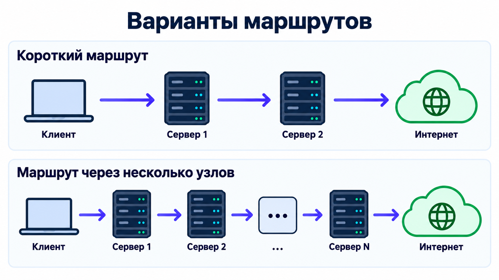

# HopLink

HopLink разворачивает цепочку UDP-реле с выходом Hysteria2 на Linux-серверах. Входной и промежуточные узлы пересылают зашифрованные пакеты средствами Go. Один QUIC/TLS-туннель соединяет клиент с последним узлом; промежуточные серверы не расшифровывают трафик. Desktop-приложение на Go/Wails позволяет хранить серверы и пользователей, собирать цепочку на интерактивной карте и синхронизировать её по SSH.

Основная инструкция на английском: [README.en.md](README.en.md).

Описание пересылки, ограничений и обновления маршрутов: [UDP-реле](docs/udp-relay.md).

## Варианты маршрутов

HopLink позволяет собрать короткий маршрут из двух серверов или добавить любое необходимое число промежуточных узлов:

## Возможности

- Перетаскивание серверов из библиотеки на карту и соединение узлов в линейную цепочку.
- Назначение входной и выходной точки. Изменение карты через «Применить» обновляет цепочку на серверах и удаляет HopLink с узлов, исключённых из карты.
- CRUD пользователей Hiddify, настройки Hysteria2 и хранение ключа цепочки и TLS-пары.
- Удаление сервисов всех маршрутов на выбранных серверах.
- Зашифрованный `settings.json` сохраняется рядом с запускаемым файлом приложения.

## Лицензия

Проект распространяется на условиях GNU Affero General Public License версии 3.0. Полный текст находится в файле [LICENSE](LICENSE).

